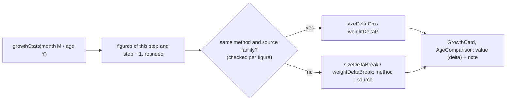

# Growth change, feeding and sleep, skills to teach

- **Date:** 2026-11-05 · **updated:** 2026-11-05
- **Status:** Implemented. The book-based content (E.A.S.Y. figures, skill items) is a draft until the content owner reviews it.
- **Backlog issue:** none
- **Scope:** `baby-tracker` only. Domains: 1 Baby Progress (changed), 5 Feeding and Sleep (new), 6 Skills to Teach (new).
- **Rules live in:** [1-baby-progress.md](../business/1-baby-progress.md) § 1.6, [5-feeding-sleep.md](../business/5-feeding-sleep.md), [6-skills.md](../business/6-skills.md). This note keeps the reasons behind them.

## User Story

As a parent reading a month page (0–24) or an age page (2–18), I want to see three things:
- how much the reference length / height and weight grew since the step before, e.g. `5.1 kg (+1.2)`;
- how often and how much to feed, and how long the child sleeps;
- which skills to teach at this step.

The goal is to know how to care for the child now.

## Why This Approach

- **The change lives in `growthStats`.** `growthStats` is the one source behind `GrowthCard` and `AgeComparison`, so both get the change without new calls. Week steps get none.
- **Figures are rounded where they are computed.** `stats.ts` rounds each figure with `roundLength` / `roundWeight` from `format.ts`, so the change is the difference of the two shown values. A plain subtraction gives `5.6 - 4.5 = 1.0999…`. Before rounding, the average weight went from 31.55 to 35.5 kg, which reads as +3.95 although the page shows 31.6 and 35.5.
- **The change is hidden at a break, and the break is found from data labels.** The two steps may differ in how size is measured (lying length → standing height, at month 24 and age 2) or in which family of reference tables a figure comes from (WHO → CDC, weight at age 11). Then only that figure's change is hidden, with a note saying why. The other figure keeps its change. The rule compares labels on each row; it never hard-codes ages. WHO 2006 and WHO 2007 count as one family, because the 2007 reference was built to join the 2006 standard at 5 years.
- **The year table was corrected to its sources.** The spec said "WHO/CDC medians", but 17 cells matched no source: weight at ages 11–18 and girls' height at age 11. They were replaced with source values, and the spec now names the source of each row. A wrong figure would also have produced a wrong change.
- **Feeding and sleep is its own domain, not a care category.** Care items are free text with three kinds. A routine needs structured numbers: interval, ml per feed, feeds per day, hours, naps.
- **Skills is its own domain.** It has a different source (a book) and a different shape: a list with a "New" badge.
- **The new sections are server-rendered and hook-free.** Content is the same for every baby, so it must be in the static HTML.
- **Texts are paraphrased.** Every book-based line is our own wording, at most two sentences, and the source is named.

## Detailed Design

### 1. Growth change (domain 1)

- `childhood-years.ts`:
  - `BodyReference` = `{ sizeMethod, sizeSource, weightSource }`.
  - `YEAR_REFERENCES` holds age bands and their references; `yearReference(age)` looks one up.
  - `SOURCE_FAMILIES` maps `who-2006` / `who-2007` → `who` and `cdc-2000` → `cdc`.
- `infant-months.ts`: `monthReference(month)` returns length before month 24 and height from month 24, both WHO 2006.
- `stats.ts`:
  - `bodyStats` returns rounded `sizeCm` / `weightG` and `measure`.
  - With a previous step, it adds `sizeDeltaCm` / `weightDeltaG`, or `sizeDeltaBreak` / `weightDeltaBreak` (`"method" | "source"`).
  - The previous step is month M−1 or age Y−1. Age 1 compares with age 0; month 0 and age 0 have no change.
- `format.ts`:
  - `roundLength` rounds to 0.1 cm.
  - `roundWeight` rounds to 1 g under 10 kg and 100 g from 10 kg.
  - `formatSizeStat` / `formatWeightStat` render `{value} ({delta})` with a locale sign and decimal mark.

> Design decisions: rounding is half up. Binary noise is stripped first (`toFixed(6)`), so an average of 126.95, stored as 126.9499…, still rounds up. Two shown averages move by 0.1 (age 8 → 127 cm, age 12 → 150.2 cm). A test pins this list.

> Design decisions: `formatLength` / `formatWeight` stay unchanged. Page metadata uses them, and SEO titles and descriptions are locked by a test case.

> Design decisions: ages 0–1 are labelled "Length" and use the month note. They are measured lying down from WHO 2006, the same figures as months 0 and 12. The SEO description template stays as it is.

### 2. Feeding and sleep (domain 5)

- `routine-stages.ts` has two tables, `FEEDING_STAGES` and `SLEEP_STAGES`. Each row has one `stepKind`, a `from`–`to` range and its sources. Together the rows cover months 0–24 and ages 2–18 with no gap and no overlap.
- `routineForStep` returns `{ feeding?, sleep? }`.
- Feeding has three shapes:
  - `MilkStage`, months 0–11: interval, ml per bottle feed, feeds per day.
  - `MealStage` for months 12–24: daily milk only.
  - `MealStage` for ages 2–18: main meals, snacks, daily dairy.
- `describeRoutine.ts` turns a stage into rows, a tip, notes and source lines.
- `RoutineSection` renders them as `dl` / `dt` / `dd`.

> Design decisions: the meal counts for months 12–24 are not repeated. The care item `family-food` already states them on the same page, and two copies would be two sources of truth.

> Design decisions: the timing comes from the E.A.S.Y. book, ml per feed from AAP, and sleep hours from WHO 2019 (AASM 2016 for older children). Naps cite E.A.S.Y. on their own line, because the medical sources give no nap counts. A fixed schedule conflicts with feeding a breastfed baby on demand, so the block says breastfed babies still feed when they ask, and the ml figures apply to bottle feeds only. The per-feed range and feeds-per-day range are separate ranges, not a product: their upper ends together can pass AAP's 960 ml daily limit, so a note says more feeds mean smaller ones.

### 3. Skills to teach (domain 6)

- `SKILL_ITEMS` is a static table: id, area, `stepKind`, `from`–`to`.
- `skillsForStep` marks an item new on its `from` step and lists new items first.
- `SkillSection` follows `CareSection` and reuses `care.newBadge`.
- Weeks and ages 0–1 have no skills.

> Design decisions: swimming practice for babies under 1 was replaced with tummy time and splashing at bath time, always with an adult holding the baby. Swimming at that age is not safe.

### 4. Texts and shared docs

- Texts are dictionary keys typed against the ids (`satisfies Record<Id, …>`), so vi and en must both be complete: `growth.*`, `routine.*`, `routineStages`, `skills.*`, `skillItems`.
- Pages render the sections in this order: growth card, boy / girl table, Feeding and sleep, Care, Skills, Vaccines.
- Shared docs updated: `AGENTS.md`, `business.md`, `test-cases.md`, `ARCHITECTURE.md`, `structure.md`, `coding-conventions.md`, `decisions.md`, `project-overview.md`, `workflow-updating-growth-content.md`.

## File summary

| File | New / Modified | Purpose |
|---|---|---|
| `src/features/locale/format.ts` (+ test) | Modified | Rounding, `formatSizeStat` / `formatWeightStat`, `formatRange` / `countRange` |
| `src/features/growth/stats.ts` (+ test) | Modified | Rounded figures, change and break per figure |
| `src/features/growth/childhood-years.ts` | Modified | Corrected year table, `yearReference`, `SOURCE_FAMILIES` |
| `src/features/growth/infant-months.ts` | Modified | `monthReference` |
| `src/components/organisms/GrowthCard.tsx`, `src/components/molecules/AgeComparison.tsx` | Modified | Show value with change, change and break notes |
| `src/features/routine/routine-stages.ts`, `describeRoutine.ts` (+ tests) | New | Feeding and sleep tables and rows |
| `src/features/skills/skill-items.ts` (+ test) | New | Skill table, skills per step |
| `src/components/organisms/RoutineSection.tsx`, `SkillSection.tsx` | New | Server-rendered sections |
| `src/app/[locale]/month/[month]/page.tsx`, `age/[age]/page.tsx` | Modified | Render the new sections |
| `src/features/locale/dictionaries/vi.ts`, `en.ts` | Modified | New texts |
| `docs/business/5-feeding-sleep.md`, `6-skills.md`, `docs/test-cases/5-*.md`, `6-*.md` | New | Specs and test cases |
| `docs/business/1-baby-progress.md`, `docs/test-cases/1-baby-progress.md` | Modified | Change rules, year sources, TC-BP-28…36 |

## Risks & Mitigations

| Risk | Impact | Mitigation | Where |
|---|---|---|---|
| Book figures and skill wording not checked against the books | Content could misstate the source | Specs mark them draft (⚠); the content owner reviews before release | 5-feeding-sleep.md, 6-skills.md |
| Copyright of the two books | Legal | Paraphrase only, ≤ 2 sentences, no quotation; a test checks sentence count | `skill-items.test.ts`, content rules § 5.5 / § 6.5 |
| A later table edit makes a change ≤ 0 or breaks a source label | Wrong "(+…)" | Change tests fail on any change ≤ 0; the workflow says to edit `YEAR_REFERENCES` with the figures | `stats.test.ts`, `workflow-updating-growth-content.md` |
| A new section turns client-side | Missing from static HTML | Sections are hook-free and listed in `structure.md` | `structure.md` Rules |
| Browser E2E not yet run (dashboard change, mobile, live `curl`) | Client-only behaviour unverified | Static HTML of all 168 guide pages checked; run TC-BP-36, TC-FS-10, TC-SK-07 on a local server | `docs/test-cases/*` |
